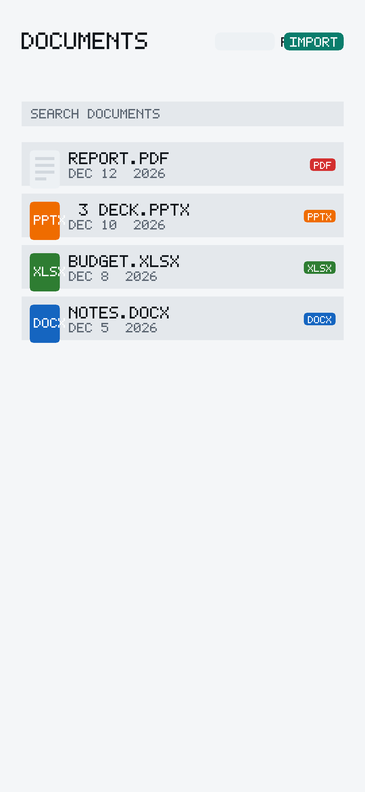
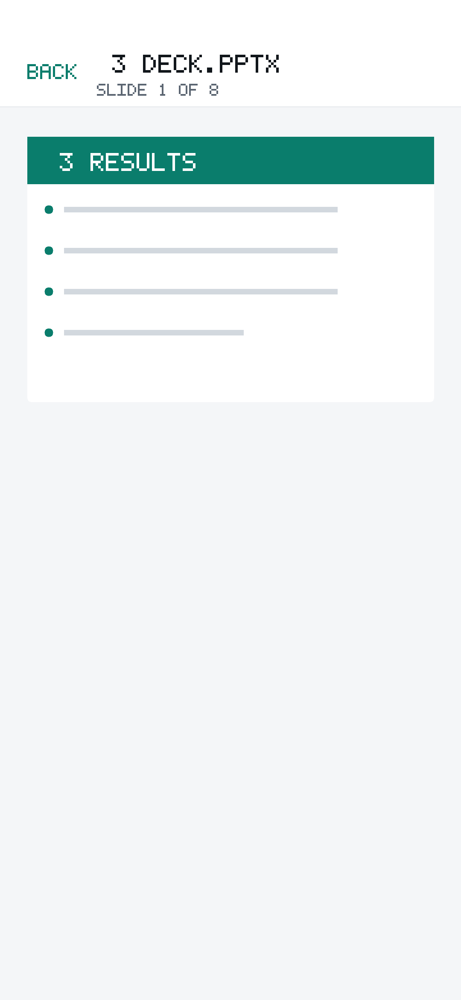

# Pdf

Cross-platform (iOS & Android) document reader/editor that works **100% offline**. No backend, no cloud sync, no authentication, and no network calls: the app opens, renders, edits, and saves PDF, DOCX, PPTX, and XLSX files entirely on the user's device. Document metadata lives in SQLite (`expo-sqlite`); raw files and thumbnails live in the app sandbox (`expo-file-system`, under `FileSystem.documentDirectory`).

## Preview

Generated mockups of the main screens (replace with device screenshots after `npx expo run:ios`):

| Document list | PDF viewer | Presentation viewer |
|---|---|---|
|  |  |  |

## Stack

- Expo SDK 54 (React Native 0.81, New Architecture), TypeScript, Zustand.
- PDF viewing: `react-native-pdf-jsi` (PDFium on Android, PDFKit on iOS).
- PDF editing: `@doko/react-native-pdf-editor` (PoDoFo, on-device).
- DOCX editing: `@shashimadushan/docx-editor-react-native` (WebView, local HTML bundle, autosave into the sandbox file).
- PPTX/XLSX viewing: `react-native-anydoc` (Rust, on-device) converting to a JSON DocumentIR rendered by custom React Native components.

## Run

```
npm install
npx expo install --fix
npx expo run:ios      # or: npx expo run:android
```

iOS: after adding native dependencies run `npx pod-install` (or a fresh `npx expo run:ios`, which installs pods automatically). Android: PoDoFo requires `minSdkVersion >= 26`, already set via the `expo-build-properties` plugin in `app.json`.

## Test / typecheck

```
npm test          # Node-based unit tests with mocked native modules (scripts/)
npm run typecheck # tsc --noEmit
```

## Architecture

See [architecture.md](architecture.md) for the folder tree, state flow, SQLite schema, and native-module isolation. [tasks.md](tasks.md) is the granular implementation plan; [agents.md](agents.md) the engineering rules.

- `src/core/` — storage (SQLite schema/db/repository with filesystem consistency + orphan reconcile), fs (sandbox paths and file ops), convert (anydoc adapter), store (Zustand).
- `src/features/` — pdf (viewer + editor + thumbnails), docx (editor), pptx/xlsx (DocumentIR viewers), each behind a typed adapter with lazy guarded loading and graceful fallback.
- `src/ui/` — navigation, screens, components (cards, banners, error boundary, IR renderers).

Every native engine failure is caught and surfaced as a friendly banner or read-only fallback; the app never crashes on a bad file.
